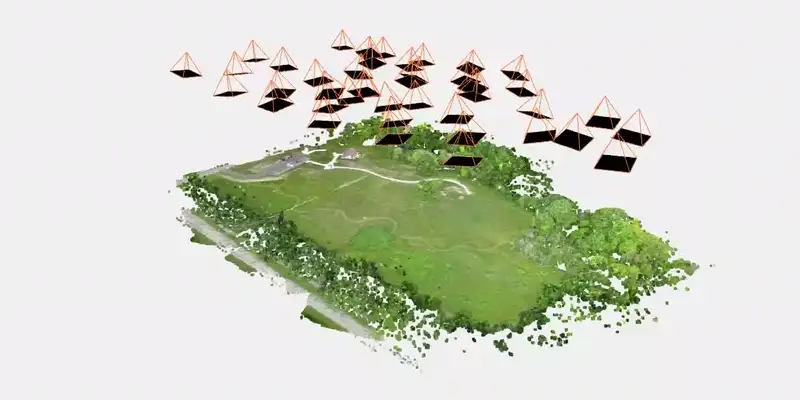
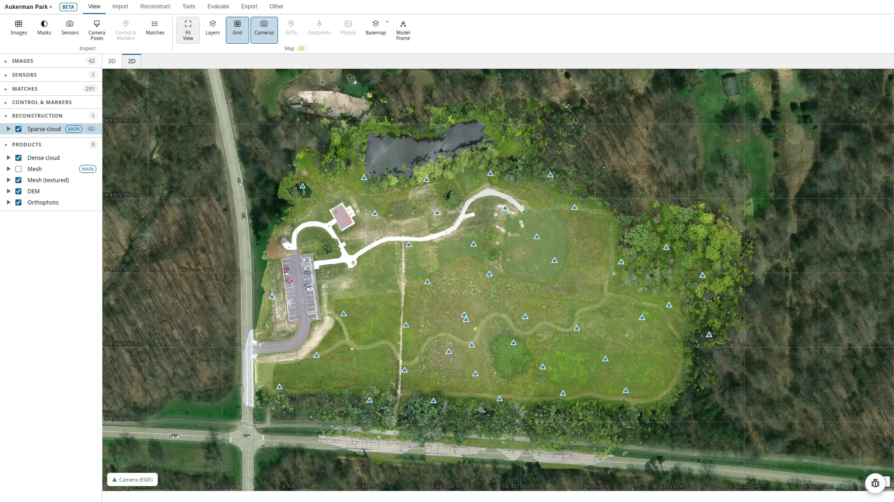
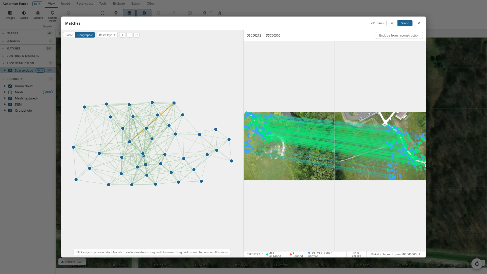
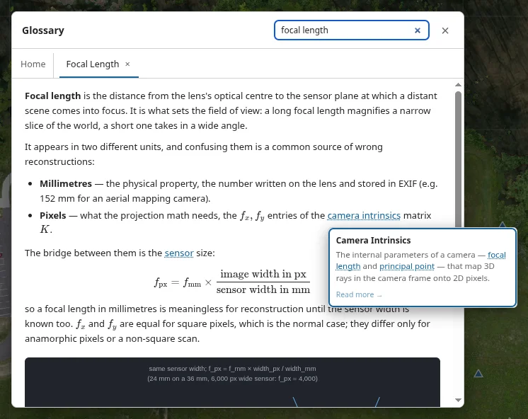
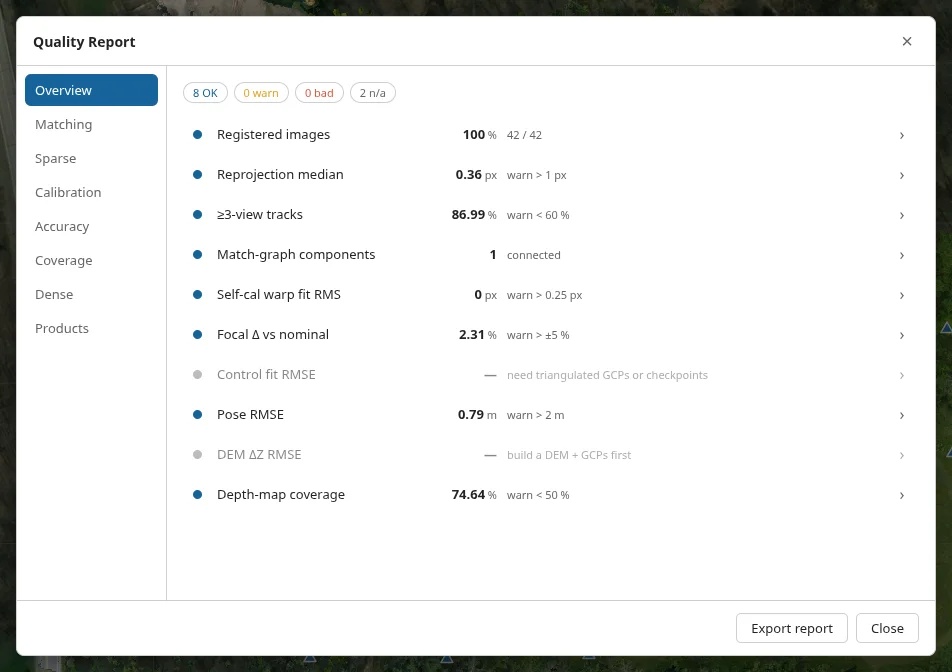
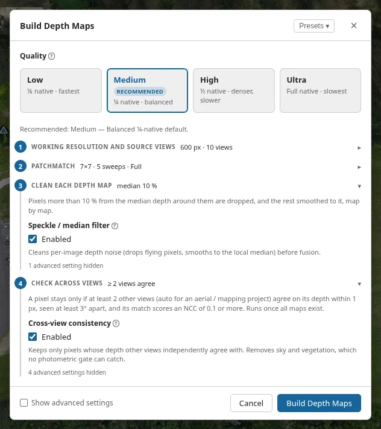

# WebSfM

**Structure-from-Motion and photogrammetry, entirely in your browser.**

[](https://websfm.app)
[](https://github.com/fdahle/websfm/actions/workflows/verify.yml)
[](LICENSE)

[Why WebSfM](#why-websfm) · [First project](#your-first-project) ·
[What works](#what-works-today) · [Browsers](#browser-requirements) ·
[How it's tested](#how-its-tested) · [Roadmap](#roadmap) · [How it works](#how-it-works) ·
[From source](#running-from-source) · [Reporting a problem](#reporting-a-problem) ·
[License](#license)

<!-- An animated image plays by itself and loops; a video would need a click. -->


WebSfM turns overlapping photographs into 3D reconstructions (sparse and dense point
clouds, meshes, digital elevation models and orthophotos) without installing anything
and **without uploading your images anywhere**.

**Try it at [websfm.app](https://websfm.app).**

> [!NOTE]
> **Beta.** WebSfM is at version 0.x: the pipeline is complete, but not every path has
> been checked on real data yet ([what has been](#how-its-tested)); those features carry an
> **Experimental** badge in the app. Please report
> anything that breaks or looks wrong with the **🐞 button** in the app, or as an
> [issue](https://github.com/fdahle/websfm/issues). What changed in each release is
> under **Other ▸ What's New** in the app and in [CHANGELOG.md](CHANGELOG.md).

## Why WebSfM

- **Private.** All the computing runs on your machine, in background workers. Your
  photos never leave it.
- **Nothing to install.** Open the page and start; projects are kept in your browser,
  or in a folder you choose (Chromium).
- **Measured.** Results are scored against RTK positions, surveyed checkpoints, ETH3D
  ground truth and airborne LiDAR, next to COLMAP, Metashape and OpenDroneMap on the
  same images ([How it's tested](#how-its-tested)).
- **Familiar.** The stages, settings and words of Metashape, COLMAP and ODM. Every
  setting says on hover what it does and when to change it.
- **Built for georeferencing.** Any coordinate reference system, polar and non-WGS84
  ones included (historical aerial imagery of Antarctica, for one), with ground
  control, RTK priors and reference DEMs throughout.
- **Open.** MIT licensed, and every method is explained in the app and in
  [docs/METHODS.md](docs/METHODS.md), with the papers it comes from.

## Your first project

No photos at hand? In the first dialog (or the project picker), choose **Open the
example project**. It downloads 42 drone photos of a park in Ohio (about 50 MB) and
opens a step-by-step walkthrough in the guide, from feature detection to a 3D point
cloud, an elevation model and an orthophoto. With a graphics card (WebGPU) the
computing takes about two minutes; without one, about four at lower quality.

The photos are [OpenDroneMap's Aukerman dataset](https://github.com/OpenDroneMap/odm_data_aukerman),
which they share as public domain (CC0 1.0). Many thanks to OpenDroneMap and its
contributors for making real survey data free to use.

With your own photos: create a project, drop the images onto the sidebar, and
follow **Other ▸ Guide ▸ Getting Started**. Hover a setting's label with a **?** for what
it does, or a dotted-underlined term for what it means; the glossary explains the
methods behind each stage.

## What works today


<sub>Background imagery: Esri World Imagery (Source: Esri, Vantor, Earthstar Geographics, and the GIS User Community).</sub>

| Area | Highlights |
| --- | --- |
| **Import** | Photos, video (frames picked by camera motion and sharpness), masks, camera poses and calibration, GCP files, reference DEMs and orthophotos, point clouds and meshes; projects from COLMAP, Metashape, OpenSfM, OpenMVG, NVM and Bundler |
| **Alignment** | SIFT or learned detectors (ALIKED, DISK, SuperPoint); brute-force or LightGlue matching with RANSAC verification; incremental reconstruction with bundle adjustment and self-calibration, fisheye lenses included; the Workflow Builder runs the stages in one go, with quality gates between them |
| **Georeferencing** | GCPs marked in the photos or on the map, or found automatically against a reference orthophoto; RTK and EXIF camera positions; scale bars; any CRS (proj4); DEM co-registration |
| **Dense** | PatchMatch depth maps on the graphics card (WebGPU) or the CPU, fused into a dense point cloud |
| **Products** | DSM and bare-earth DTM, true orthophoto, screened-Poisson mesh with texture, reflectance maps from multispectral cameras, contours, slope, aspect and hillshade |
| **Clouds and meshes** | Filter, remove outliers, subsample, crop, merge, transform, align by point pairs or ICP, classify ground, estimate normals; clean, smooth, decimate and texture meshes |
| **Measure** | Distances, areas, profiles and volumes on the map and in 3D, DEM of difference, cloud-to-reference distances, sections |
| **Historical imagery** | Film scans: fiducial detection and calibration, reseau grids, half-frame scans, panoramic satellite strips |
| **Quality** | The Quality Report: matching, sparse model, calibration, checkpoint accuracy, coverage, depth coverage, DEM against a reference |
| **Export** | Point clouds as PLY, LAS, LAZ, COPC or XYZ; meshes as PLY, glTF, OBJ or STL; Cesium 3D Tiles; DEMs as GeoTIFF, Cloud-Optimized GeoTIFF or ESRI ASCII; orthophotos as GeoTIFF, Cloud-Optimized GeoTIFF, PNG or JPEG with a world file, MBTiles or XYZ tiles; camera poses and calibration; projects for COLMAP, OpenMVG, VisualSFM, Metashape and NeRF tools (transforms.json); undistorted images |
| **Help** | A guide article for every operation, a glossary of the methods with their references, and What's New |

Every command, with its place in the ribbon and the guide article that explains it, is
listed in [docs/features.md](docs/features.md).

<table>
  <tr>
    <td width="60%"></td>
    <td width="40%"></td>
  </tr>
  <tr>
    <td>Every image pair's matches, as a graph and side by side</td>
    <td>Each method explained in the app, with linked terms</td>
  </tr>
  <tr>
    <td width="60%"></td>
    <td width="40%"></td>
  </tr>
  <tr>
    <td>The Quality Report: how each stage went, and what to fix first</td>
    <td>Every processing dialog: a quality choice, then its settings in run order</td>
  </tr>
</table>

<sub>The screenshots are taken from the example project by `npm run screenshots`.</sub>

## Browser requirements

- A **Chromium-based browser** (Chrome, Edge, Brave, …) is recommended. The app
  uses [OPFS](https://developer.mozilla.org/docs/Web/API/File_System_API/Origin_private_file_system)
  for local project storage; folder-backed projects and WebGPU acceleration are
  Chromium-only. **Firefox** runs the whole pipeline on the CPU, and the browser test
  suite runs in it as well as in Chromium. The suite also runs in WebKit, Safari's
  engine; **Safari** itself has not been tried on real data. The app lists what a
  browser lacks, and what it costs, when it starts.
- The learned backends (ALIKED, DISK, SuperPoint, LightGlue, Smart Select) download their model
  weights on first use — you'll be asked to confirm, and each file is cached
  locally afterwards (see [Model files](docs/deployment.md#model-files)).

## How it's tested

The compute code has a large suite of unit and regression tests, and any change to
how the sparse solver stores its data must reproduce recorded results bit for bit.
A headless bench runs the real pipeline (ingest, detection, matching, SfM, depth
maps, fusion) in headless Chrome, using the same workers, WASM and WebGPU code as
the app, with fresh browser storage for every run. Wherever a dataset has
independent reference data, results are scored against it: RTK camera positions,
surveyed GCPs held out as checkpoints, ETH3D ground truth and airborne LiDAR. COLMAP,
Metashape and OpenDroneMap (ODM) run on the same images on the same machine for
comparison.

Latest results (October–November 2026):

| Dataset | Images registered | Result | Compared against |
| --- | --- | --- | --- |
| Aerial survey block with RTK and 15 surveyed GCPs | 444 / 444 | Checkpoints: 3.4 cm horizontal, 11.1 cm vertical; cameras 1.8 / 1.2 cm (RTK camera priors, no GCP used as control) | Metashape, same priors: cameras 0.5 / 1.0 cm |
| Same block, pure SfM (no GCPs, no RTK) | 444 / 444 | Cameras vs RTK: 26.5 cm H / 14.6 cm V; 351 s from detection to sparse model | COLMAP: 24.0 / 65.0 cm, 1,511 s; ODM: 35.8 / 94.7 cm |
| Quarry, Pix4D example (RTK in EXIF), pure SfM | 346 / 347 | Cameras vs RTK: 20.3 cm H / 13.4 cm V | COLMAP: 49.5 / 84.7 cm; Metashape: 13 / 12 cm; ODM: 58.0 / 11.6 cm |
| Three drone blocks (224–444 photos), whole pipeline at defaults: dense cloud, DSM, ortho, textured mesh | all | 35–50 min, 13–23 GiB (smaller mesh and ortho than the others make by default) | Metashape: 48–68 min, 10–14 GiB; ODM: 65–102 min, 28–41 GiB |
| COLMAP South Building | 128 / 128 | 64,662 sparse points | COLMAP: 84,954 points |
| Bundle Adjustment in the Large: 98 problems, 16–13,682 cameras (bundle adjustment alone) | – | Final cost a median 0.00004 % from Ceres', 84 of 95 within 1 % of it or lower, at 1.4× its time; the 3 largest not solved in 2 h | Ceres 2.2 |
| ETH3D high-res, 6 training scenes (dense, from ground-truth cameras, ETH3D's evaluator) | – | Mean F1 66.2 at 2 cm; 827 s for all six on WebGPU | COLMAP dense: 58.4; Metashape Medium: 447 s, about 2.5 points of F1 higher (approximate scorer) |
| Casa Grande 1978 aerial film (37 scans, 11 GCP checkpoints) | 37 / 37 | DEM vs 1 m reference: RMSE 1.42 m, NMAD 0.73 m | COLMAP: 13.0 / 13.5 m; Metashape defaults: 13 / 37 cameras |

Every table, with its date, method and the weak results, is in
[docs/BENCHMARKS.md](docs/BENCHMARKS.md).

Known gaps: COLMAP and Metashape register every image of ETH3D's low-texture
interiors at their defaults (WebSfM: 20 / 26 and 8 / 14; all of them when detecting at
4,000 px). COLMAP keeps 40–260 % more sparse points. Metashape's dense clouds are more
accurate at 2 cm and more complete on open outdoor scenes, and take about half
WebSfM's time at the same quality setting.

Not yet verified:

- Safari on real data. Firefox and WebKit (Safari's engine) run the browser test
  suite; real datasets have only been run in Chromium.
- WebGPU on other GPUs. Every GPU number above comes from one NVIDIA GPU.
- Exported meshes and 3D Tiles in external tools. (DEMs and orthophotos as COG, LAS,
  LAZ, COPC and the COLMAP model are read back by GDAL, PDAL and COLMAP in CI.)
- Interactive workflows end to end in a browser: GCP marking and georeferencing,
  scale bars, film fiducial calibration, meshing, and the learned detectors.
- Project portability: reopening a saved `.websfm` in a fresh browser profile, and
  folder-backed projects.
- Volume measurements against an independent tool.

## Roadmap

Recently shipped: automatic ground control from a reference orthophoto, bare-earth
DTMs, fisheye lenses, textured meshes, 3D measurement and DEM-of-difference volumes,
ALIKED and LightGlue, Workflow Builder gates, satellite film cameras (reseau grids,
half-frame scans), and multi-threaded bundle adjustment.

**Now**
- Checking recent features in real browsers on real datasets, so "shipped" also
  means "verified", then the next beta
- Parity with established SfM tools (COLMAP, Metashape) on standard benchmarks,
  measured for accuracy, robustness and speed

**Next**
- Dense reconstruction of large projects beyond one browser tab's memory
  (out-of-core fusion, tiled meshing)
- Projects past the 4 GB WebAssembly memory limit, once 64-bit WebAssembly is
  available in the toolchain
- Denser depth maps on weakly textured surfaces (snow, ice, water edges)

**Later**
- Bundle adjustment constrained by a reference DEM, to correct long strips without
  ground control
- The motion of panoramic satellite cameras during the scan
- Content-based automatic masking (film frames, colour keys, low-texture areas)

Priorities follow real use: the [roadmap board](https://github.com/users/fdahle/projects/1)
has an issue for each item, so comment on the one that matters to you, or open an
issue for something missing.

## How it works

The app is Vue 3 and Pinia; everything heavy runs in a pool of web workers, so the
page stays responsive during a run.

| Layer | Where | Job |
| --- | --- | --- |
| Interface | [`src/components/`](src/components/), [`src/stores/`](src/stores/) | The ribbon, dialogs and 2D/3D viewers; each project's state, saved in browser storage (OPFS) |
| Workers | [`src/workers/`](src/workers/) | Run every processing step off the page, spread over all CPU cores; WebGPU kernels for matching and depth maps |
| Core | [`src/core/`](src/core/) | The pipeline's computation in plain JavaScript: tracks, depth-map filtering and fusion, DEMs, orthophotos, georeferencing, readers and writers. It touches no interface or storage (a lint rule checks), so it runs in the workers and in the Node tests alike |
| Rust | [`crates/`](crates/), compiled to [`src/wasm/`](src/wasm/) | The numerical kernels: SIFT, matching and geometric verification, camera pose, multi-threaded bundle adjustment, PatchMatch, Poisson meshing, LAZ and image codecs |
| Models | ONNX Runtime Web | The learned detectors and matcher (ALIKED, DISK, SuperPoint, LightGlue) and Smart Select masks |

[ARCHITECTURE.md](ARCHITECTURE.md) follows one operation through these layers and
says which files a change touches.

## Running from source

With [Node.js](https://nodejs.org/) 22 (20.19 or later works; CI uses 22). No Rust is
needed: the compiled WASM is committed.

```bash
npm install
npm run fetch:examples   # optional: the example dataset
npm run dev
npm run check            # formatting, types, lint and unit tests, as CI runs them
```

| For | Read |
| --- | --- |
| Using the app | the in-app guide and glossary (source: [`src/guide/`](src/guide/), [`src/glossary/`](src/glossary/)) |
| Running and testing from source | [docs/development.md](docs/development.md) |
| How the code is organised | [ARCHITECTURE.md](ARCHITECTURE.md) |
| The algorithms and why they were chosen | [docs/METHODS.md](docs/METHODS.md) |
| How it compares with COLMAP, Metashape and ODM | [docs/BENCHMARKS.md](docs/BENCHMARKS.md) |
| Hosting your own copy | [docs/deployment.md](docs/deployment.md) |
| Contributing | [CONTRIBUTING.md](CONTRIBUTING.md) |
| What changed | [CHANGELOG.md](CHANGELOG.md), or **Other ▸ What's New** in the app |

### What's in this repository

| Folder | Holds |
| --- | --- |
| [`src/`](src/) | the app: Vue components, Pinia stores, the web workers, and [`src/core/`](src/core/), the pure computation that also runs in the tests |
| [`src/guide/`](src/guide/), [`src/glossary/`](src/glossary/) | the in-app help, as Markdown |
| [`crates/`](crates/) | the Rust code (SIFT, matching, reconstruction, dense, mesh, codecs), compiled to WebAssembly in [`src/wasm/`](src/wasm/) |
| [`tests/`](tests/) | browser tests (Playwright) and the headless pipeline bench; unit tests sit beside their code as `*.test.js` |
| [`scripts/`](scripts/) | developer tools: the bench, model and example downloads, WASM builds, releases, deploys |
| [`public/`](public/) | static files served as they are: icons, geoid grids, hosting headers |
| [`deploy/`](deploy/) | hosting configs: the Cloudflare Worker of websfm.app, an nginx config for your own server |
| [`docs/`](docs/) | the documentation above, and the README's images |

At the top level, `Dockerfile` builds an image for hosting your own copy, `AGENTS.md`
and `CLAUDE.md` are notes for AI coding tools, and the other files configure the build,
tests and formatting.

## How it is developed

WebSfM is developed with substantial help from AI coding tools, mainly
[Claude Code](https://claude.com/claude-code); commits written with AI assistance
are marked as such in the git history. The direction, the choice of photogrammetric
methods and the review of every change rest with the maintainer: the tools speed up
implementation, they do not decide what the software does or vouch for its
correctness.

In practice:

- **Verify before relying on results.** As with any research tool in beta, check
  reconstructions and measurements, and compare georeferenced results against known
  control.
- **Every method is documented.** The in-app glossary (**Other ▸ Glossary**, source
  in [`src/glossary/`](src/glossary/)) and [docs/METHODS.md](docs/METHODS.md)
  explain what each stage does, so the algorithms can be judged on their merits.
- **Testing is stated openly.** [How it's tested](#how-its-tested) lists what has
  been checked against independent reference data, and what has not yet.

## Reporting a problem

Bug reports are especially valuable while not every code path has met real data.

1. Click the **🐞 button** in the app's corner (or open
   [an issue](https://github.com/fdahle/websfm/issues/new)) and say what you did, what
   happened, and what kind of photos they were: how many, which camera, aerial or
   close-range.
2. Attach the log: open the console (**Other ▸ Console**, or Ctrl+\`, ⌘+\` on a Mac)
   and click **Save TXT**. The file starts with your browser, GPU and memory, then lists every
   step that ran, with its settings, timings and warnings. It is plain text you can
   read before you share it; it holds no photos, and nothing is sent anywhere unless
   you attach it.

Results on your own data, good or bad, are just as welcome in
[Discussions](https://github.com/fdahle/websfm/discussions). To contribute code, see
[CONTRIBUTING.md](CONTRIBUTING.md). Security issues go through
[SECURITY.md](SECURITY.md), not public issues.

## License

WebSfM is released under the [MIT License](LICENSE). The third-party code, models and
data it includes keep their own licenses: [THIRD_PARTY.md](THIRD_PARTY.md) lists them,
and every build ships their texts as `THIRD_PARTY_NOTICES.txt`, shown in the app under
**About ▸ Licenses**. The SuperPoint weights are licensed for non-commercial research
only and are not distributed with WebSfM.
