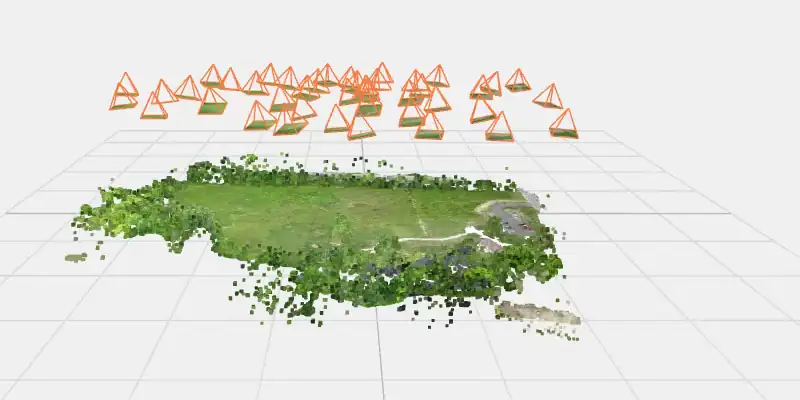
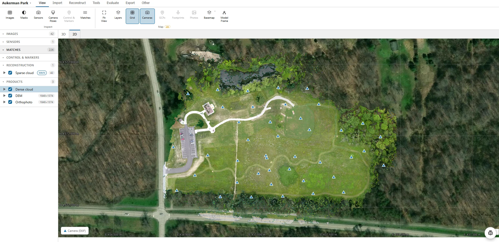
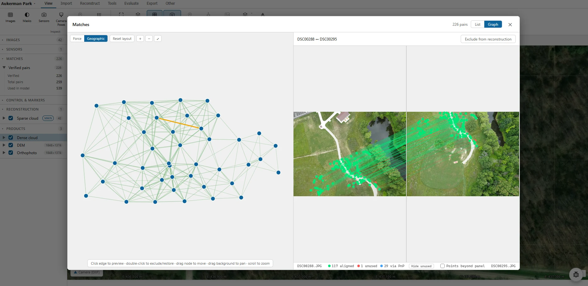
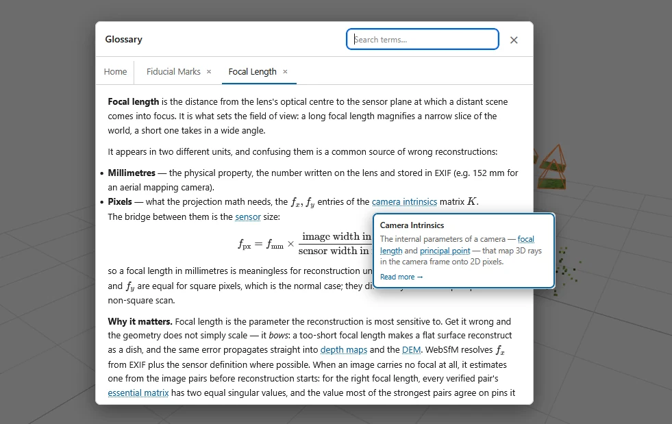

# WebSfM

**Structure-from-Motion and photogrammetry, entirely in your browser.**

[](https://websfm.app)
[](https://github.com/fdahle/websfm/actions/workflows/verify.yml)
[](LICENSE)

<!-- An animated image plays by itself and loops; a video would need a click. It
     links to the full-quality recording. -->
[](https://github.com/user-attachments/assets/4462ade2-6796-4ae4-812a-9f00b34e333b)

WebSfM turns overlapping photographs into 3D reconstructions — sparse and dense
point clouds, meshes, digital elevation models and orthophotos — without
installing anything and **without uploading your images anywhere**. All the
computation runs locally: the heavy numerical work (feature detection, matching,
bundle adjustment, dense multi-view stereo) is written in Rust, compiled to
WebAssembly, and executed in a background worker thread. Your photos never leave
your machine.

It is built with a focus on **polar / non-WGS84 projects** (e.g. historical
aerial imagery of Antarctica), so coordinate-reference-system handling and ground
control are first-class throughout.

**Try it at [websfm.app](https://websfm.app).** Nothing to install; the app runs on
your machine and keeps your projects in your browser.

> [!NOTE]
> **Beta.** WebSfM is at version 0.x: the pipeline is complete, but not every path has
> been checked on real data yet ([what has been](#how-its-tested)). Please report
> anything that breaks or looks wrong with the **🐞 button** in the app, or as an
> [issue](https://github.com/fdahle/websfm/issues). What changed in each release is
> under **Other ▸ What's New** in the app and in [CHANGELOG.md](CHANGELOG.md).

---

## Your first project

No photos at hand? In the first dialog (or the project picker), choose **Open the
example project**. It downloads 42 drone photos of a park in Ohio (about 50 MB) and
opens a step-by-step walkthrough in the guide, from feature detection to a 3D point
cloud, an elevation model and an orthophoto. With a graphics card (WebGPU) the
computing takes about two minutes; without one, about four at lower quality.

The photos are [OpenDroneMap's Aukerman dataset](https://github.com/OpenDroneMap/odm_data_aukerman),
which they share as public domain (CC0 1.0). Many thanks to OpenDroneMap and its
contributors for making real survey data free to use.

With your own photos: create a project, drop the images onto the sidebar, and
follow **Other ▸ Guide ▸ Getting Started**. Hover a setting's underlined label for what
it does, and the glossary explains the methods behind each stage.

## What it does



A full photogrammetry pipeline, stage by stage:

1. **Detect** – SIFT (Rust/WASM) or a learned detector (ALIKED, DISK, SuperPoint).
2. **Match** – brute-force descriptor matching or the learned LightGlue matcher,
   with fundamental-matrix RANSAC verification.
3. **Sparse SfM** – incremental reconstruction with P3P resection, LM bundle
   adjustment, self-calibration, and track filtering.
4. **Dense MVS** – PatchMatch depth maps fused into a dense point cloud
   (CPU/WASM, or an experimental WebGPU backend).
5. **Products** – DEM and bare-earth DTM, true orthophoto, and a screened-Poisson
   mesh, optionally textured.
6. **Georeferencing** – ground control points, camera poses, and reference DEMs,
   with reprojection into any project CRS (proj4).

<table>
  <tr>
    <td width="60%"></td>
    <td width="40%"></td>
  </tr>
  <tr>
    <td>Every image pair's matches, as a graph and side by side</td>
    <td>Each method explained in the app, with linked terms</td>
  </tr>
</table>

There's also an in-app guide and glossary, a quality-report hub, point-cloud
editing, 2D and 3D measurement, video import (frames picked by camera motion and
sharpness), historical film scans (fiducials, reseau grids), COLMAP / PLY / LAS /
LAZ / GeoTIFF import & export, COPC import and 3D Tiles export.

## Browser requirements

- A **Chromium-based browser** (Chrome, Edge, Brave, …) is recommended. The app
  uses [OPFS](https://developer.mozilla.org/docs/Web/API/File_System_API/Origin_private_file_system)
  for local project storage; folder-backed projects and WebGPU acceleration are
  Chromium-only. Firefox and Safari work with reduced acceleration.
- The learned backends (ALIKED, DISK, SuperPoint, LightGlue, Smart Select) download their model
  weights on first use — you'll be asked to confirm, and each file is cached
  locally afterwards (see [Model files](docs/deployment.md#model-files)).

---

## Documentation

| For | Read |
| --- | --- |
| Using the app | the in-app guide and glossary (source: [`src/guide/`](src/guide/), [`src/glossary/`](src/glossary/)) |
| Running and testing from source | [docs/development.md](docs/development.md) |
| How the code is organised | [ARCHITECTURE.md](ARCHITECTURE.md) |
| The algorithms and why they were chosen | [docs/METHODS.md](docs/METHODS.md) |
| Hosting your own copy | [docs/deployment.md](docs/deployment.md) |
| Contributing | [CONTRIBUTING.md](CONTRIBUTING.md) |
| What changed | [CHANGELOG.md](CHANGELOG.md), or **Other ▸ What's New** in the app |

Quick start from source, with [Node.js](https://nodejs.org/) 22 (20.19 or later works;
CI uses 22). No Rust is needed: the compiled WASM is committed.

```bash
npm install
npm run fetch:examples   # optional: the example dataset
npm run dev
```

## How it's tested

The compute code has a large suite of unit and regression tests, and any change to
how the sparse solver stores its data must reproduce recorded results bit for bit.
A headless bench runs the real pipeline (ingest, detection, matching, SfM, depth
maps, fusion) in headless Chrome, using the same workers, WASM and WebGPU code as
the app, with fresh browser storage for every run. Wherever a dataset has
independent reference data, results are scored against it: RTK camera positions,
surveyed GCPs held out as checkpoints, and ETH3D ground truth. COLMAP 4.0.3 is run on
the same images on the same machine for comparison.

Latest results (October 2026):

| Dataset | Images registered | Result | Compared against |
| --- | --- | --- | --- |
| Aerial survey block with RTK and 15 surveyed GCPs | 444 / 444 | Checkpoints: 3.2–3.4 cm horizontal, ~7 cm vertical (RTK camera priors, no GCP used as control) | Surveyed GCPs |
| Same block, pure SfM (no GCPs, no RTK) | 444 / 444 | Cameras vs RTK: 24.8 cm H / 49.6 cm V | COLMAP: 24.0 / 65.0 cm |
| Quarry, Pix4D example (RTK in EXIF), pure SfM | 347 / 347 | Cameras vs RTK: 28.7 cm H / 70.2 cm V, ~530 s end to end | COLMAP: 49.5 / 84.7 cm, 1,104 s |
| COLMAP South Building | 128 / 128 | 60,045 sparse points | COLMAP: 84,954 points |
| ETH3D high-res, 13 scenes (dense, from ground-truth cameras) | – | Mean F1 52.6 at 2 cm, 76.0 at 10 cm | COLMAP dense: 59.1 / 81.0 |
| Historical Antarctic aerial film (USGS, 97 MP scans) | 5 / 5 | Self-calibrated, median reprojection error 1.48 px | – |

The ETH3D figures come from an approximation of the official scorer, so they compare
WebSfM with COLMAP rather than with the public leaderboard.

Known gaps: without GCPs or camera priors, nadir blocks bend into a dome of about
0.5–0.7 m (COLMAP's dome is larger on the same images). COLMAP keeps 40–260 % more
sparse points, and dense accuracy at 2 cm is behind COLMAP.

Not yet verified:

- Firefox and Safari. So far only Chromium has been exercised.
- WebGPU on other GPUs. Every GPU number above comes from one NVIDIA GPU.
- Exported files in external tools: GeoTIFF/COG in QGIS or GDAL, LAZ in
  CloudCompare, the COLMAP export round trip.
- Interactive workflows end to end in a browser: GCP marking and georeferencing,
  scale bars, film fiducial calibration, meshing, and the learned detectors.
- Project portability: reopening a saved `.websfm` in a fresh browser profile, and
  folder-backed projects.
- Volume measurements against an independent tool.

## Roadmap

Recently shipped: automatic ground control from a reference orthophoto, bare-earth
DTMs, fisheye lenses, textured meshes, 3D measurement and DEM-of-difference volumes,
ALIKED and LightGlue, Workflow Builder gates, satellite film cameras (reseau grids,
half-frame scans), and multi-threaded bundle adjustment.

**Now**
- Checking recent features in real browsers on real datasets, so "shipped" also
  means "verified", then the next beta
- Parity with established SfM tools (COLMAP, Metashape) on standard benchmarks,
  measured for accuracy, robustness and speed

**Next**
- Dense reconstruction of large projects beyond one browser tab's memory
  (out-of-core fusion, tiled meshing)
- Projects past the 4 GB WebAssembly memory limit, once 64-bit WebAssembly is
  available in the toolchain
- Better georeferenced accuracy without ground control (less dome-shaped distortion)
- Denser depth maps on weakly textured surfaces (snow, ice, water edges)

**Later**
- Bundle adjustment constrained by a reference DEM, to correct long strips without
  ground control
- The motion of panoramic satellite cameras during the scan
- Content-based automatic masking (film frames, colour keys, low-texture areas)

Priorities follow real use: the [roadmap board](https://github.com/users/fdahle/projects/1)
has an issue for each item, so comment on the one that matters to you, or open an
issue for something missing.

## How it is developed

WebSfM is developed with substantial help from AI coding tools, mainly
[Claude Code](https://claude.com/claude-code); commits written with AI assistance
are marked as such in the git history. The direction, the choice of photogrammetric
methods and the review of every change rest with the maintainer: the tools speed up
implementation, they do not decide what the software does or vouch for its
correctness.

In practice:

- **Verify before relying on results.** As with any research tool in beta, check
  reconstructions and measurements, and compare georeferenced results against known
  control.
- **Every method is documented.** The in-app glossary (**Other ▸ Glossary**, source
  in [`src/glossary/`](src/glossary/)) and [docs/METHODS.md](docs/METHODS.md)
  explain what each stage does, so the algorithms can be judged on their merits.
- **Testing is stated openly.** [How it's tested](#how-its-tested) lists what has
  been checked against independent reference data, and what has not yet.

Bug reports are especially valuable while not every code path has met real data.

## Feedback

Found a bug or have a suggestion? Use the 🐞 button in the app, or open an issue:
**[github.com/fdahle/websfm/issues](https://github.com/fdahle/websfm/issues)**.
To contribute code, see [CONTRIBUTING.md](CONTRIBUTING.md). Security issues go
through [SECURITY.md](SECURITY.md), not public issues.

## License

WebSfM is released under the [MIT License](LICENSE). Bundled third-party code and
the downloadable model weights keep their own licenses, listed in the app under
**About**. Note that the SuperPoint weights are licensed for non-commercial research
only and are not distributed with websfm.
