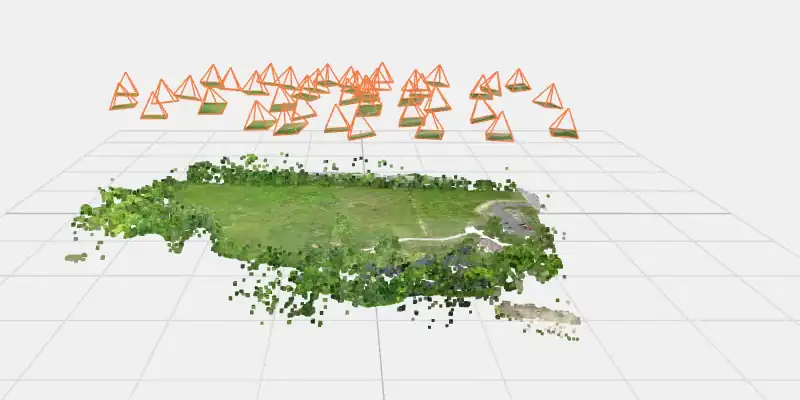
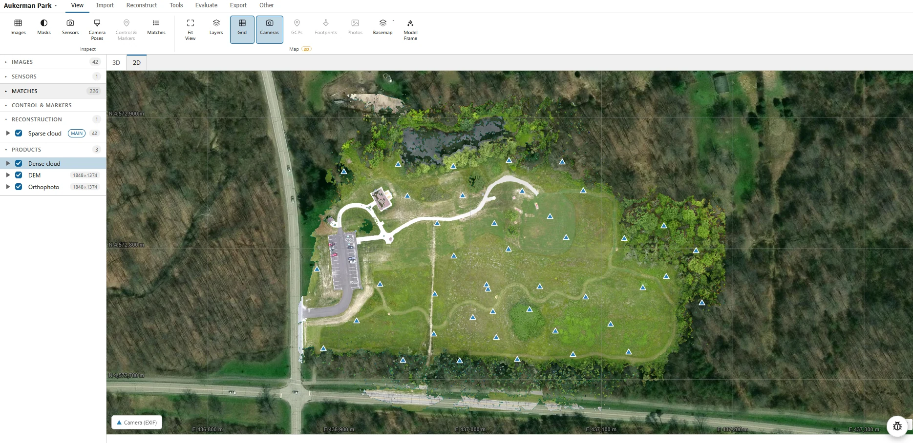
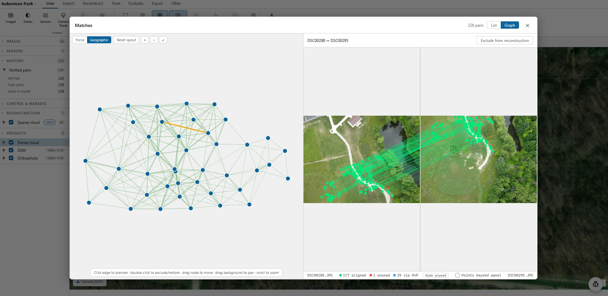
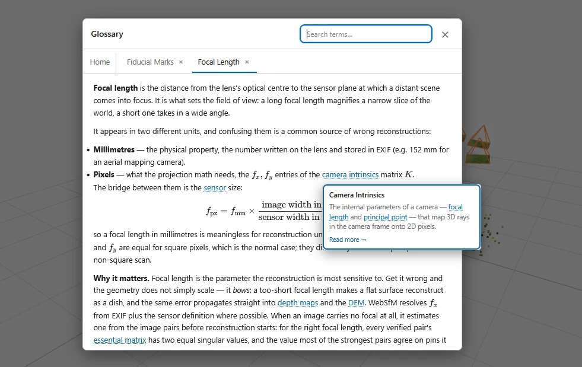

# WebSfM

**Structure-from-Motion and photogrammetry, entirely in your browser.**

[](https://websfm.app)
[](https://github.com/fdahle/websfm/actions/workflows/verify.yml)
[](LICENSE)

<!-- An animated image plays by itself and loops; a video would need a click. -->


WebSfM turns overlapping photographs into 3D reconstructions — sparse and dense
point clouds, meshes, digital elevation models and orthophotos — without
installing anything and **without uploading your images anywhere**. All the
computation runs locally, in background workers, and your photos never leave your
machine. The innermost numerical kernels are written in Rust and compiled to
WebAssembly: SIFT, descriptor matching and geometric verification, camera pose,
bundle adjustment, PatchMatch depth maps and Poisson meshing. With WebGPU, matching
and depth maps run on the graphics card instead, and the learned detectors run as
ONNX models. The rest of the pipeline is JavaScript: track building, the depth-map
filter and fusion into a point cloud, DEMs, orthophotos, georeferencing and the
exporters.

It is built with a focus on **polar / non-WGS84 projects** (e.g. historical
aerial imagery of Antarctica), so coordinate-reference-system handling and ground
control are first-class throughout.

**Try it at [websfm.app](https://websfm.app).** Nothing to install; the app runs on
your machine and keeps your projects in your browser.

> [!NOTE]
> **Beta.** WebSfM is at version 0.x: the pipeline is complete, but not every path has
> been checked on real data yet ([what has been](#how-its-tested)); those features carry an
> **Experimental** badge in the app. Please report
> anything that breaks or looks wrong with the **🐞 button** in the app, or as an
> [issue](https://github.com/fdahle/websfm/issues). What changed in each release is
> under **Other ▸ What's New** in the app and in [CHANGELOG.md](CHANGELOG.md).

---

## Your first project

No photos at hand? In the first dialog (or the project picker), choose **Open the
example project**. It downloads 42 drone photos of a park in Ohio (about 50 MB) and
opens a step-by-step walkthrough in the guide, from feature detection to a 3D point
cloud, an elevation model and an orthophoto. With a graphics card (WebGPU) the
computing takes about two minutes; without one, about four at lower quality.

The photos are [OpenDroneMap's Aukerman dataset](https://github.com/OpenDroneMap/odm_data_aukerman),
which they share as public domain (CC0 1.0). Many thanks to OpenDroneMap and its
contributors for making real survey data free to use.

With your own photos: create a project, drop the images onto the sidebar, and
follow **Other ▸ Guide ▸ Getting Started**. Hover a setting's label with a **?** for what
it does, or a dotted-underlined term for what it means; the glossary explains the
methods behind each stage.

## What it does


<sub>Background imagery: Esri World Imagery (Source: Esri, Vantor, Earthstar Geographics, and the GIS User Community).</sub>

A full photogrammetry pipeline, stage by stage:

1. **Detect** – SIFT (Rust/WASM) or a learned detector (ALIKED, DISK, SuperPoint).
2. **Match** – brute-force descriptor matching or the learned LightGlue matcher,
   with fundamental-matrix RANSAC verification.
3. **Sparse SfM** – incremental reconstruction with P3P resection, LM bundle
   adjustment, self-calibration, and track filtering.
4. **Dense MVS** – PatchMatch depth maps fused into a dense point cloud, on the GPU
   (WebGPU) or the CPU (WASM).
5. **Products** – DEM and bare-earth DTM, true orthophoto, and a screened-Poisson
   mesh, optionally textured.
6. **Georeferencing** – ground control points, camera poses, and reference DEMs,
   with reprojection into any project CRS (proj4).

<table>
  <tr>
    <td width="60%"></td>
    <td width="40%"></td>
  </tr>
  <tr>
    <td>Every image pair's matches, as a graph and side by side</td>
    <td>Each method explained in the app, with linked terms</td>
  </tr>
</table>

There's also an in-app guide and glossary, a quality-report hub, point-cloud
editing, 2D and 3D measurement, video import (frames picked by camera motion and
sharpness), historical film scans (fiducials, reseau grids), COLMAP / PLY / LAS /
LAZ / GeoTIFF import & export, COPC import and 3D Tiles export.

## Browser requirements

- A **Chromium-based browser** (Chrome, Edge, Brave, …) is recommended. The app
  uses [OPFS](https://developer.mozilla.org/docs/Web/API/File_System_API/Origin_private_file_system)
  for local project storage; folder-backed projects and WebGPU acceleration are
  Chromium-only. **Firefox** runs the whole pipeline on the CPU, and the browser test
  suite runs in it as well as in Chromium. The suite also runs in WebKit, Safari's
  engine; **Safari** itself has not been tried on real data. The app lists what a
  browser lacks, and what it costs, when it starts.
- The learned backends (ALIKED, DISK, SuperPoint, LightGlue, Smart Select) download their model
  weights on first use — you'll be asked to confirm, and each file is cached
  locally afterwards (see [Model files](docs/deployment.md#model-files)).

---

## Documentation

| For | Read |
| --- | --- |
| Using the app | the in-app guide and glossary (source: [`src/guide/`](src/guide/), [`src/glossary/`](src/glossary/)) |
| Running and testing from source | [docs/development.md](docs/development.md) |
| How the code is organised | [ARCHITECTURE.md](ARCHITECTURE.md) |
| The algorithms and why they were chosen | [docs/METHODS.md](docs/METHODS.md) |
| How it compares with COLMAP, Metashape and ODM | [docs/BENCHMARKS.md](docs/BENCHMARKS.md) |
| Hosting your own copy | [docs/deployment.md](docs/deployment.md) |
| Contributing | [CONTRIBUTING.md](CONTRIBUTING.md) |
| What changed | [CHANGELOG.md](CHANGELOG.md), or **Other ▸ What's New** in the app |

### What's in this repository

| Folder | Holds |
| --- | --- |
| [`src/`](src/) | the app: Vue components, Pinia stores, the web workers, and [`src/core/`](src/core/), the pure computation that also runs in the tests |
| [`src/guide/`](src/guide/), [`src/glossary/`](src/glossary/) | the in-app help, as Markdown |
| [`crates/`](crates/) | the Rust code (SIFT, matching, reconstruction, dense, mesh, codecs), compiled to WebAssembly in [`src/wasm/`](src/wasm/) |
| [`tests/`](tests/) | browser tests (Playwright) and the headless pipeline bench; unit tests sit beside their code as `*.test.js` |
| [`scripts/`](scripts/) | developer tools: the bench, model and example downloads, WASM builds, releases, deploys |
| [`public/`](public/) | static files served as they are: icons, geoid grids, hosting headers |
| [`deploy/`](deploy/) | hosting configs: the Cloudflare Worker of websfm.app, an nginx config for your own server |
| [`docs/`](docs/) | the documentation above, and the README's images |

At the top level, `Dockerfile` builds an image for hosting your own copy, `AGENTS.md`
and `CLAUDE.md` are notes for AI coding tools, and the other files configure the build,
tests and formatting.

Quick start from source, with [Node.js](https://nodejs.org/) 22 (20.19 or later works;
CI uses 22). No Rust is needed: the compiled WASM is committed.

```bash
npm install
npm run fetch:examples   # optional: the example dataset
npm run dev
```

## How it's tested

The compute code has a large suite of unit and regression tests, and any change to
how the sparse solver stores its data must reproduce recorded results bit for bit.
A headless bench runs the real pipeline (ingest, detection, matching, SfM, depth
maps, fusion) in headless Chrome, using the same workers, WASM and WebGPU code as
the app, with fresh browser storage for every run. Wherever a dataset has
independent reference data, results are scored against it: RTK camera positions,
surveyed GCPs held out as checkpoints, ETH3D ground truth and airborne LiDAR. COLMAP,
Metashape and OpenDroneMap (ODM) run on the same images on the same machine for
comparison.

Latest results (October–November 2026):

| Dataset | Images registered | Result | Compared against |
| --- | --- | --- | --- |
| Aerial survey block with RTK and 15 surveyed GCPs | 444 / 444 | Checkpoints: 3.4 cm horizontal, 11.1 cm vertical; cameras 1.8 / 1.2 cm (RTK camera priors, no GCP used as control) | Metashape, same priors: cameras 0.5 / 1.0 cm |
| Same block, pure SfM (no GCPs, no RTK) | 444 / 444 | Cameras vs RTK: 26.5 cm H / 14.6 cm V; 351 s from detection to sparse model | COLMAP: 24.0 / 65.0 cm, 1,511 s; ODM: 35.8 / 94.7 cm |
| Quarry, Pix4D example (RTK in EXIF), pure SfM | 346 / 347 | Cameras vs RTK: 20.3 cm H / 13.4 cm V | COLMAP: 49.5 / 84.7 cm; Metashape: 13 / 12 cm; ODM: 58.0 / 11.6 cm |
| Three drone blocks (224–444 photos), whole pipeline at defaults: dense cloud, DSM, ortho, textured mesh | all | 35–50 min, 13–23 GiB (smaller mesh and ortho than the others make by default) | Metashape: 48–68 min, 10–14 GiB; ODM: 65–102 min, 28–41 GiB |
| COLMAP South Building | 128 / 128 | 64,662 sparse points | COLMAP: 84,954 points |
| Bundle Adjustment in the Large: 98 problems, 16–13,682 cameras (bundle adjustment alone) | – | Final cost a median 0.00004 % from Ceres', 84 of 95 within 1 % of it or lower, at 1.4× its time; the 3 largest not solved in 2 h | Ceres 2.2 |
| ETH3D high-res, 6 training scenes (dense, from ground-truth cameras, ETH3D's evaluator) | – | Mean F1 66.2 at 2 cm; 827 s for all six on WebGPU | COLMAP dense: 58.4; Metashape Medium: 447 s, about 2.5 points of F1 higher (approximate scorer) |
| Casa Grande 1978 aerial film (37 scans, 11 GCP checkpoints) | 37 / 37 | DEM vs 1 m reference: RMSE 1.42 m, NMAD 0.73 m | COLMAP: 13.0 / 13.5 m; Metashape defaults: 13 / 37 cameras |

Every table, with its date, method and the weak results, is in
[docs/BENCHMARKS.md](docs/BENCHMARKS.md).

Known gaps: COLMAP and Metashape register every image of ETH3D's low-texture
interiors at their defaults (WebSfM: 20 / 26 and 8 / 14; all of them when detecting at
4,000 px). COLMAP keeps 40–260 % more sparse points. Metashape's dense clouds are more
accurate at 2 cm and more complete on open outdoor scenes, and take about half
WebSfM's time at the same quality setting.

Not yet verified:

- Safari on real data. Firefox and WebKit (Safari's engine) run the browser test
  suite; real datasets have only been run in Chromium.
- WebGPU on other GPUs. Every GPU number above comes from one NVIDIA GPU.
- Exported meshes and 3D Tiles in external tools. (DEMs and orthophotos as COG, LAS,
  LAZ, COPC and the COLMAP model are read back by GDAL, PDAL and COLMAP in CI.)
- Interactive workflows end to end in a browser: GCP marking and georeferencing,
  scale bars, film fiducial calibration, meshing, and the learned detectors.
- Project portability: reopening a saved `.websfm` in a fresh browser profile, and
  folder-backed projects.
- Volume measurements against an independent tool.

## Roadmap

Recently shipped: automatic ground control from a reference orthophoto, bare-earth
DTMs, fisheye lenses, textured meshes, 3D measurement and DEM-of-difference volumes,
ALIKED and LightGlue, Workflow Builder gates, satellite film cameras (reseau grids,
half-frame scans), and multi-threaded bundle adjustment.

**Now**
- Checking recent features in real browsers on real datasets, so "shipped" also
  means "verified", then the next beta
- Parity with established SfM tools (COLMAP, Metashape) on standard benchmarks,
  measured for accuracy, robustness and speed

**Next**
- Dense reconstruction of large projects beyond one browser tab's memory
  (out-of-core fusion, tiled meshing)
- Projects past the 4 GB WebAssembly memory limit, once 64-bit WebAssembly is
  available in the toolchain
- Denser depth maps on weakly textured surfaces (snow, ice, water edges)

**Later**
- Bundle adjustment constrained by a reference DEM, to correct long strips without
  ground control
- The motion of panoramic satellite cameras during the scan
- Content-based automatic masking (film frames, colour keys, low-texture areas)

Priorities follow real use: the [roadmap board](https://github.com/users/fdahle/projects/1)
has an issue for each item, so comment on the one that matters to you, or open an
issue for something missing.

## How it is developed

WebSfM is developed with substantial help from AI coding tools, mainly
[Claude Code](https://claude.com/claude-code); commits written with AI assistance
are marked as such in the git history. The direction, the choice of photogrammetric
methods and the review of every change rest with the maintainer: the tools speed up
implementation, they do not decide what the software does or vouch for its
correctness.

In practice:

- **Verify before relying on results.** As with any research tool in beta, check
  reconstructions and measurements, and compare georeferenced results against known
  control.
- **Every method is documented.** The in-app glossary (**Other ▸ Glossary**, source
  in [`src/glossary/`](src/glossary/)) and [docs/METHODS.md](docs/METHODS.md)
  explain what each stage does, so the algorithms can be judged on their merits.
- **Testing is stated openly.** [How it's tested](#how-its-tested) lists what has
  been checked against independent reference data, and what has not yet.

Bug reports are especially valuable while not every code path has met real data.

## Feedback

Found a bug or have a suggestion? Use the 🐞 button in the app, or open an issue:
**[github.com/fdahle/websfm/issues](https://github.com/fdahle/websfm/issues)**.
To contribute code, see [CONTRIBUTING.md](CONTRIBUTING.md). Security issues go
through [SECURITY.md](SECURITY.md), not public issues.

## License

WebSfM is released under the [MIT License](LICENSE). The third-party code, models and
data it includes keep their own licenses: [THIRD_PARTY.md](THIRD_PARTY.md) lists them,
and every build ships their texts as `THIRD_PARTY_NOTICES.txt`, shown in the app under
**About ▸ Licenses**. The SuperPoint weights are licensed for non-commercial research
only and are not distributed with WebSfM.
